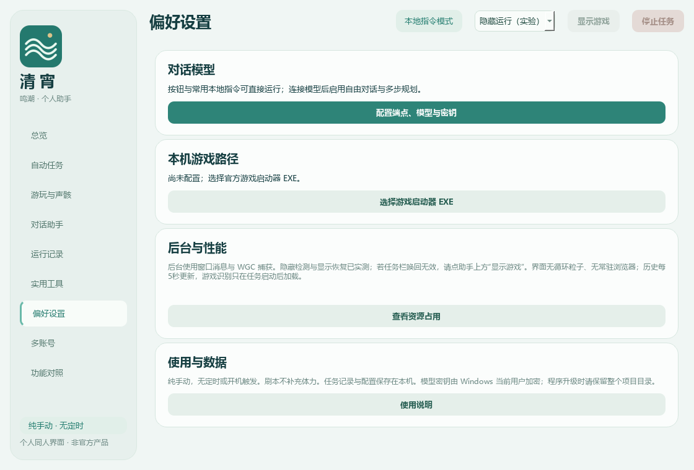

# 清宵 · 鸣潮桌面助手

基于 [OK-WW](https://github.com/ok-oldking/ok-wuthering-waves) 与 [ok-script](https://github.com/ok-oldking/ok-script) 的桌面助手二次开发。提供原生 Qt 界面、任务队列、受限对话规划、执行报告、截图回查与停止控制。非游戏官方产品。

**当前为源码预览版，尚未发布完整二进制安装包。** 公开树不包含账号、密钥、个人运行记录、角色壁纸，也不直接分发上游识别图片和模型；运行资源可由用户单独从上游获取，逐文件校验SHA-256。



## 功能状态

| 类别 | 当前范围 |
|---|---|
| 日常与刷取 | 进度检查、日常、无音区、凝素、模拟、Boss、梦魇/聚落、乐园周常 |
| 游玩辅助 | 拾取、跳对话、战斗拾取、快捷传送、剧情组合；需要手动跑路线，不自动接任务、寻路或解谜 |
| 声骸管理 | 强化、弃置融合、主属性重构；材料任务先核对规则、目标与数量 |
| 活动 | 接入v3.7.13无音消除前置与终局流程；提供时限和停止控制 |
| 账号 | 多账号入口保留，整轮验收暂缓 |
| 结果 | 队列参数快照、日志、截图、重试与不确定回执保护 |

18个任务入口、9个页面。游戏引擎以3.7.8源码为基础，选取了后续修复与v3.7.13活动功能；ok-script固定2.0.13。没有宣称整体升级为最新引擎。

## 安装与启动

要求：Windows、64位Python 3.12。完整解压到可写目录，支持中文与空格路径。

```powershell
# 安装依赖、构建启动器并检查界面；不操作游戏
powershell -NoProfile -ExecutionPolicy Bypass -File .\Setup.ps1
# 没有py命令时，可额外传 -Python "你的Python3.12路径"
# 强制使用标准pip安装可传 -UsePip
```

双击生成的“鸣潮手动助手.exe”，在偏好设置中选择官方游戏启动器。密钥在本机输入，不需要上传。仅打开APP不会启动游戏任务。

需要实际运行游戏功能时，先获取资源：

```powershell
powershell -NoProfile -ExecutionPolicy Bypass -File .\Setup.ps1 -FetchResources
```

此步骤直接访问上游固定版本的公开资源，核对全部文件校验值；已被用户修改的资源不会被静默覆盖。请自行核对并遵守上游项目及相关资源条款。依赖和运行资源的许可不因本仓库源码许可而改变。

随后手动运行 `Install-Local-Tasks.ps1` 安装三个按需权限任务，按系统提示处理管理员权限。没有定时或开机触发。遇到来自其他项目目录的同名任务会拒绝覆盖或操作。首次登录、验证码与更新提示由本人处理。

保留整个项目目录。换电脑或移动目录后应重新安装环境，不能只复制EXE或旧虚拟环境。

## 数据与停止

- `local-config.json`保存本机路径；`local-runs/`保存配置、任务报告和截图；`local-game-config/`由引擎生成。这些内容均被Git忽略。
- 不上传真实账号、UID截图、模型密钥或加密凭据。外部模型只能安排目录任务，材料项仍需核对确认。
- 只使用自然体力，不自动使用备用体力、溶剂或星声。停止按钮停止本轮并清空等待队列。
- 重构提交回执不确定时停止并禁止直接重试。活动运行到时不等于全部活动完成。

## 测试与限制

```powershell
.\.venv\Scripts\python.exe -I release_tools
un_checks.py
.\.venv\Scripts\python.exe -I release_tools\smoke_test.py
.\.venv\Scripts\python.exe -I release_toolsetch_upstream_resources.py --check
```

本机已验证原环境、独立uv环境、从源码ZIP创建的pip环境；9页在1120×760及1440×960下检查通过，EXE实际启动与关闭通过。离线测试隔离游戏输入。公开版增加资源下载、校验、路径隔离的回归检查。

同机新环境不能代替另一台Windows电脑的捕获、权限安装、登录和实际任务验收。新重构、无音消除、快捷传送与剧情组合仍有实跑待测项。高级Boss参数、角色/热键完整设置、队伍代码与工坊尚未完整开放。详见 [发布状态](RELEASE_STATUS.md)。

## 许可与来源

本仓库所发布的源码按 **GNU AGPL-3.0** 提供，见 [LICENSE](LICENSE)。这是对OK-WW的修改版本，修改日期2026-10-30；原作者版权与许可说明保留。

[ok-script](https://github.com/ok-oldking/ok-script) 及其他外部依赖保留各自许可；其中ok-script包含Commons Clause和额外条款，不能把整个运行栈解释为纯Apache-2.0或无限制商用。未捆绑分发其二进制包。完整组合安装包的许可兼容性和第三方资源分发范围仍需核实，本次仅发布源码预览。见 [第三方说明](THIRD_PARTY_NOTICES.md)。
